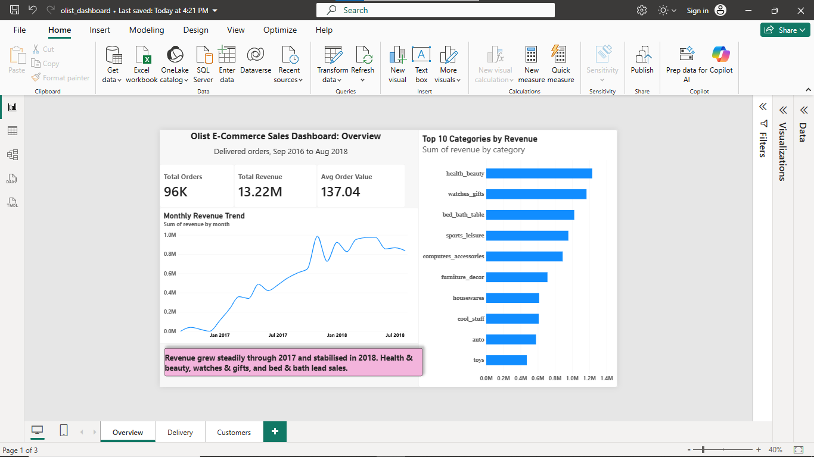
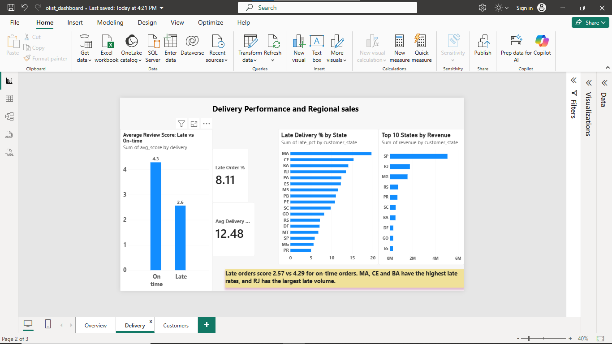
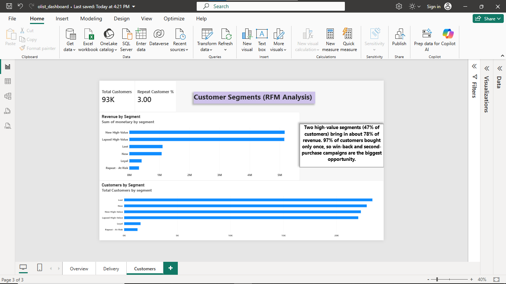

# Olist E-Commerce Analysis (SQL + Python + Power BI)

End-to-end analysis of the Brazilian Olist e-commerce dataset: sales trends, delivery performance and customer segmentation.

Dataset: Brazilian E-Commerce Public Dataset by Olist (Kaggle), orders from 2016-2018. Raw files are not included, so please download them from Kaggle.

## Tools
MySQL (joins, CTEs, window functions), Python (pandas) for RFM segmentation, Power BI (DAX measures, 3-page dashboard)

## Key findings
- 96,478 delivered orders generated about 13.22M BRL in product revenue. Average order value is 137.04.
- Late deliveries hurt ratings: on-time orders average 4.29 stars, late orders 2.57. 8.11% of orders arrive late, and average delivery takes 12.5 days.
- Sao Paulo brings about 38% of revenue. SP, RJ and MG together bring about 63%.
- Late rates are highest in the northeast: MA 19.7%, CE 15.3%, BA 14.0%. RJ also has 13.5% late orders on a very large volume.
- 97% of customers bought only once.
- RFM segmentation: two high-value segments (47% of customers) bring about 78% of revenue.

## Recommendations
1. Win-back campaign for lapsed high-value customers (22,044 customers).
2. Second-purchase offer for new high-value customers.
3. Improve logistics in RJ and in the northeast states (MA, CE, BA).
4. Reward the small loyal segment and avoid heavy spend on low-value segments.

## Dashboard

## Project structure
sql/ - analysis queries | notebooks/ - RFM analysis | results/ - exported query results | dashboard/ - Power BI file | images/ - screenshots

## How to reproduce
1. Download the dataset from Kaggle and load the CSV files into a MySQL database.
2. Run sql/olist_analysis.sql.
3. Run notebooks/rfm_analysis.ipynb.
4. Open dashboard/olist_dashboard.pbix in Power BI Desktop.
